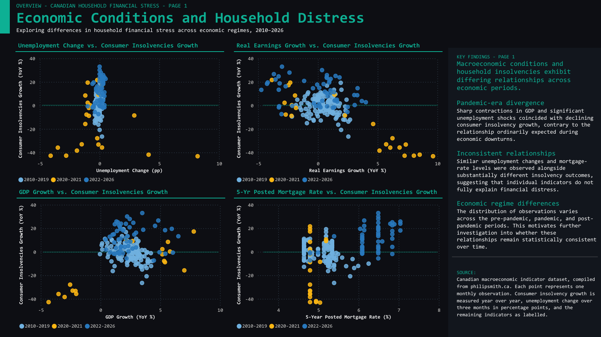
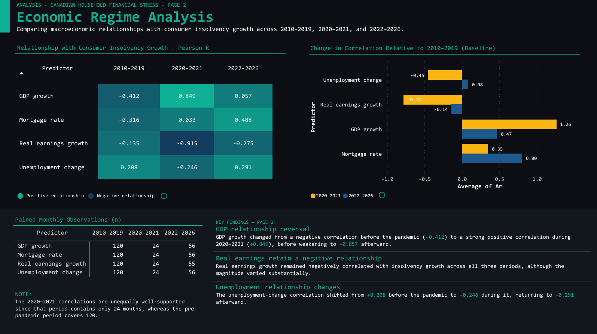

# Canadian Macroeconomic \& Financial Risk Intelligence

**An extensible Canadian economic data platform and collection of applied financial-risk analytics case studies.**

This repository brings together a normalized longitudinal database of Canadian macroeconomic indicators, data-quality checks, reproducible PostgreSQL queries, Python analyses, and interactive Power BI reports. The first case study investigates Canadian household financial distress through consumer insolvency data and changes in labour-market, earnings, economic-growth, and mortgage-rate conditions.

> \*\*Project status (October 2026):\*\* Core CSV dataset and database view definitions available; household financial stress exploratory, lag, and initial forecasting analyses documented. The editable Power BI project and original 253 raw CSV files must still be copied from the development computer. The dashboard previews below are \*\*placeholders\*\*, not screenshots of the completed report.

## At a glance

|Item|Current scope|
|-|-|
|Economic series|**253** distinct indicators|
|Long-format observations|**100,670** indicator–date records|
|Overall historical coverage|**January 1914–October 2026** (varies greatly by indicator)|
|Data platform|Python, PostgreSQL, SQL, Power BI|
|Canonical fact table|`public.observations`|
|Metadata/quality table|`public.data\_quality\_report`|
|First case study|[Household Financial Stress](processed/Household_Insolvency_Features_Pandemic_and_PrePandemic/README.md)|

**Scope note:** 1914–2026 describes the earliest-to-latest date across all series; it does not mean every indicator covers the entire range. Indicator `level` values cannot be compared across series without their units and definitions.

## Why this project exists

Public economic data portals excel at showing individual historical indicators. This project instead focuses on questions requiring **combined indicators, historical-period comparisons, lead–lag relationships, out-of-sample model evaluation, and documented analytical limitations**. Its purpose is a traceable workflow from source CSVs through database views to analytical reports.

This is a research/portfolio project, not a credit-decision engine, personal financial advice, or a production forecasting service.

## Dashboard preview

<table>
  <tr>
    <td width="50%" align="center">
      
      <br/><strong>Economic Conditions and Household Distress</strong>
    </td>
    <td width="50%" align="center">
      
      <br/><strong>Economic Regime Analysis</strong>
    </td>
  </tr>
</table>

## Current case study: Household Financial Stress

**Research question:** How stable are the relationships between Canadian economic conditions and consumer insolvency growth across pre-pandemic, pandemic, and post-pandemic periods—and do selected macroeconomic indicators improve a six-month-ahead retrospective prediction?

The analysis compares **2010–2019, 2020–2021, and 2022–2026**, using unemployment changes, real earnings growth, GDP growth, and the five-year posted conventional mortgage rate. It then compares 0-, 3-, 6-, and 12-month historical lags for the pre- and post-pandemic periods and evaluates a small retrospective forecast experiment.

### Main results

1. **Regime-dependent associations.** GDP growth's contemporaneous correlation with consumer insolvency YoY growth was **−0.412** pre-pandemic, **+0.849** during the pandemic, and **+0.057** afterward. Unemployment and mortgage-rate associations also changed direction; real earnings growth remained negatively correlated but changed in magnitude.
2. **Lag sensitivity.** At six months, real earnings growth's correlation shifted from **−0.152** (pre-pandemic) to **−0.694** (post-pandemic). GDP growth and unemployment changes also exhibited lag-specific reversals. These are descriptive correlations, not formal structural-break or predictive-validity tests.
3. **Forecast comparison.** On the January 2025–August 2026 test sample, the historical-only Ridge regression achieved **4.670 pp MAE**, compared with **6.446 pp MAE** for the version with real earnings, unemployment changes, and mortgage-rate changes. Adding those predictors **did not improve** test-set accuracy in this experiment.

**Interpretation:** The usefulness of selected Canadian macroeconomic indicators for describing household distress is conditional on the period and analytical method; the study does not demonstrate that macroeconomic indicators are generally incapable of forecasting insolvencies.

Read the [Household Financial Stress case-study document](processed/Household_Insolvency_Features_Pandemic_and_PrePandemic/README.md) for definitions, evidence, model design, charts, and caveats.

## Repository layout

```text
Canadian-Macro-Financial-Risk/
├── README.md
├── database/
│   ├── schema/                         # PostgreSQL table definitions
│   └── views/                          # PostgreSQL reporting/feature views
├── demo/
│   ├── dashboard-preview-page-1.svg    # Placeholder; replace with screenshot
│   ├── dashboard-preview-page-2.svg    # Placeholder; replace with screenshot
│   ├── Household-Financial-Stress\_Economic\_Conditions\_page\_1.pdf  # Add locally
│   └── Household-Financial-Stress\_Economic\_Conditions\_page\_2.pdf  # Add locally
├── processed/
│   ├── Household\_Insolvency\_Features\_Pandemic\_and\_PrePandemic/
│   │   ├── README.md                   # Detailed case-study document
│   │   ├── forecast\_results/
│   │   │   ├── forecast\_metrics.csv
│   │   │   └── forecast\_predictions.csv
│   │   ├── 24\_lag\_analysis\_insolvency\_stability.csv
│   │   ├── 24\_lag\_analysis\_insolvency.csv
│   │   ├── v\_bi\_lag\_profiles.csv
│   │   ├── v\_bi\_regime\_correlations.csv
│   │   ├── v\_bi\_regime\_shifts.csv
│   │   ├── v\_household\_stress\_features.csv
│   │   └── v\_insolvency\_forecast\_6m.csv
│   ├── data\_quality\_report\_consolidated.csv
│   ├── macroeconomic\_features\_consolidated.csv
│   └── v\_indicator\_catalog.csv
├── raw/                                # Original downloaded source CSVs (add locally)
├── scripts/
│   ├── load\_to\_postgres.py
│   ├── evaluate\_insolvency\_models.py
│   └── validate\_dataset.py
├── canadian household risk.pbix         # Editable Power BI report (add locally)
├── indicator\_manifest.csv              # Audit-derived manifest; metadata incomplete
├── requirements.txt
└── .gitignore / .gitattributes / .env.example
```

The two demo PDFs, the PBIX file, and the original source CSVs are **intended repository contents but are not included in this starter**. They must be copied from the development computer. The manifest's unknown unit/source/frequency fields are intentionally blank pending verification.

## Architecture and data flow

```text
Economic indicator CSVs / compiled data source
               │
               ▼
   Python consolidation \[original acquisition ETL to be added]
               │
               ▼
processed/macroeconomic\_features\_consolidated.csv
               │
               ▼
PostgreSQL: public.observations + public.data\_quality\_report
               │
          SQL views / feature definitions
               │
       ┌───────┴─────────┐
       ▼                 ▼
 Power BI (.pbix)    Python model evaluation
       │                 │
       └────────┬────────┘
                ▼
  Documented case studies and reproducible results
```

## Getting started

**Prerequisites:** Python 3.11+, PostgreSQL, pgAdmin (or another SQL client), Power BI Desktop, and GitHub Desktop.

1. Install Python dependencies: `py -m pip install -r requirements.txt`.
2. Validate consolidated data and the household feature exports: `py scripts\\validate\_dataset.py`.
3. Create an empty PostgreSQL database, then run `database/schema/00\_tables.sql`.
4. Import `processed/macroeconomic\_features\_consolidated.csv` into `public.observations` and `processed/data\_quality\_report\_consolidated.csv` into `public.data\_quality\_report` using CSV/UTF-8 with headers. Alternatively run `py scripts\\load\_to\_postgres.py --replace` with local PostgreSQL environment variables; **this truncates both base tables**.
5. Run `database/views/\*.sql` **in numbered order** to recreate the catalogue and reporting views. The `processed/` CSVs are exports, while the SQL views define the transformations.
6. Regenerate forecast evaluations with `py scripts\\evaluate\_insolvency\_models.py`.
7. Open `canadian household risk.pbix` after copying it into the repository root, update its PostgreSQL connection, and refresh data in Power BI.

## Adding a new analysis

Use a dedicated folder under `processed/<study-name>/` for its feature tables, outputs, and a detailed `README.md`. Add reusable SQL definitions under `database/views/` and modelling code under `scripts/`. Future analyses can reuse the central indicator catalogue and observations table without duplicating the full database.

Possible subsequent studies include housing-market sensitivity, household credit exposure, consumer spending and durable goods, business-cycle indicators, and sector vulnerability. These are **proposals**, not completed analyses.

## Roadmap

* \[x] Consolidated long-format dataset and QA exports.
* \[x] Canonical PostgreSQL base schema and BI-facing SQL view definitions.
* \[x] Household Financial Stress exploratory analysis, lag comparisons, and initial forecast outputs.
* \[ ] Add final dashboard previews/PDFs and commit the editable four-page Power BI `.pbix`.
* \[ ] Add original raw source files and downloader/consolidation ETL scripts, with source metadata.
* \[ ] Verify public redistribution rights and upstream series citations.
* \[ ] Add automated SQL-view validation and release-date/vintage-aware research where warranted.
* \[ ] Expand with further documented economic-risk case studies.

\---

**Status:** Research and portfolio demonstration. Findings are empirical observations from specified periods and methods, not general-purpose credit-risk predictions. Source files were compiled from [philipsmith.ca](https://philipsmith.ca/); upstream providers, licences, series units, and update metadata require indicator-level verification before public redistribution.

